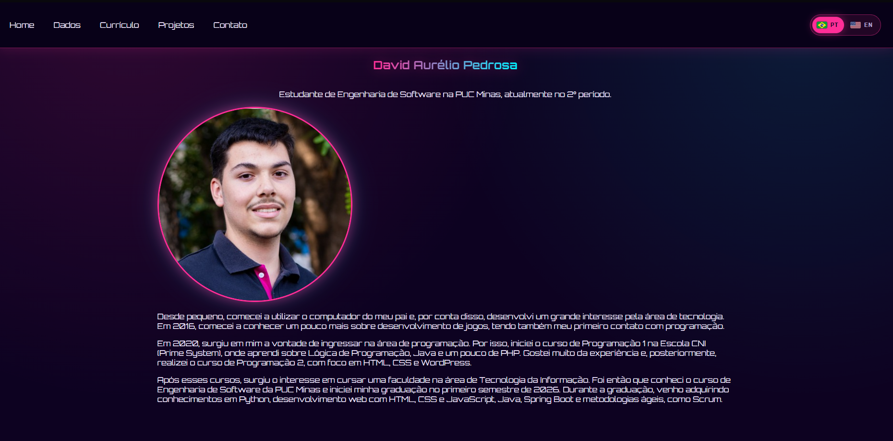

# 🎮 Portfólio — David Aurélio Pedrosa

Portfólio pessoal em estilo **gamer / cyberpunk (Synthwave)**, feito para apresentar meus projetos, minha formação e minhas estatísticas de código em tempo real.

🔗 **Acesse:** [Clique para acessar o Portfólio](https://www.dvdaurelio.dev)



## ✨ Funcionalidades

- 🌐 **Site bilíngue (PT-BR / EN)** com seletor de bandeiras. O idioma é detectado pelo navegador e a escolha fica salva.
- 📊 **Estatísticas do WakaTime:** linguagens mais usadas, horas por linguagem, total de horas e data de entrada na plataforma.
- 🐙 **Estatísticas do GitHub:** perfil, repositórios, estrelas, linguagens e projetos recentes, buscados pela API pública do GitHub.
- 🗂️ **Projetos** em cards, com descrição, imagem e link para o repositório.
- 📄 **Currículo** com visualização em PDF e botão de download.
- 📬 **Contato** com LinkedIn, GitHub e e-mail.
- 🎨 **Tema Synthwave** controlado por variáveis CSS, em um único arquivo (`theme.css`).
- 📱 **Layout responsivo.**

## 🛠️ Tecnologias

| Área               | Ferramentas                                              |
| ------------------ | -------------------------------------------------------- |
| Front-end          | React, Vite, React Router                                |
| Tradução           | i18next, react-i18next, i18next-browser-languagedetector |
| Ícones e bandeiras | react-icons, country-flag-icons                          |
| Estilo             | CSS puro com variáveis, fonte Orbitron                   |
| Dados externos     | WakaTime (gráfico embutido), API pública do GitHub       |
| Hospedagem         | Vercel (com função serverless)                           |

## 🤖 Uso de IA no desenvolvimento

Este projeto foi desenvolvido por mim com o auxílio do **Claude**, usado como assistente para:

- tirar dúvidas e entender erros durante o desenvolvimento;
- sugerir soluções e revisar trechos de código;
- apoiar a configuração da tradução, a integração com WakaTime e GitHub e o deploy na Vercel.

As decisões do projeto, a escolha das cores e dos conteúdos, os textos e a revisão final do código são meus. Usei a ferramenta como apoio para aprender e acelerar o trabalho.

## 📁 Estrutura

```
Portfolio/
├── api/
│   └── wakatime-badge.js     # Função serverless da Vercel (lê o total de horas)
├── public/
├── src/
│   ├── assets/               # Imagens e currículo (PDF)
│   ├── components/           # Header, WakaTime, GitHubStats, LanguageSwitcher...
│   ├── config/               # i18nConfig e wakaTimeConfig
│   ├── data/                 # Ícones e cores das linguagens
│   ├── i18n/                 # Configuração e arquivos de tradução (pt-BR e en)
│   ├── pages/                # Home, Dados, Currículo, Projetos e Contato
│   ├── index.css
│   ├── theme.css             # Paleta de cores do site
│   └── main.jsx
├── vercel.json               # Redirecionamento das rotas do React Router
└── package.json
```

## 🚀 Como rodar localmente

Pré-requisito: [Node.js](https://nodejs.org) (versão LTS recente).

```bash
# 1. Clonar o repositório
git clone https://github.com/DavidAurelio07/Portfolio.git
cd Portfolio

# 2. Instalar as dependências
npm install

# 3. Iniciar o servidor de desenvolvimento
npm run dev
```

O site abre em `http://localhost:5173`.

Para gerar a versão de produção:

```bash
npm run build
```

## ⚙️ Configuração do WakaTime

Os dados de código vêm de `src/config/wakaTimeConfig.js`:

- `SHARE_URL`: link JSON do gráfico de linguagens, criado em _wakatime.com/share/embed_.
- `PROFILE_URL`: link do perfil público.
- `JOINED_DATE`: data em que entrei no WakaTime.
- `FALLBACK_TOTAL_SECONDS`: total de horas usado caso o selo do WakaTime não possa ser lido.

> O total de horas é buscado por uma função serverless (`api/wakatime-badge.js`) para contornar o bloqueio de CORS. Em desenvolvimento local, ele depende do proxy configurado no `vite.config.js`.

## 🎨 Personalizando o tema

Todas as cores ficam no início do `src/theme.css`. Para trocar a paleta inteira, basta alterar as variáveis:

```css
:root {
  --bg: #0d0221;
  --surface: #1a1033;
  --primary: #ff2e97; /* rosa */
  --secondary: #00f0ff; /* ciano */
  --accent: #f9f002; /* amarelo */
}
```

## 🌍 Deploy

O projeto é publicado na **Vercel**, conectado a este repositório. Cada `git push` na branch `main` gera um novo deploy automaticamente.
